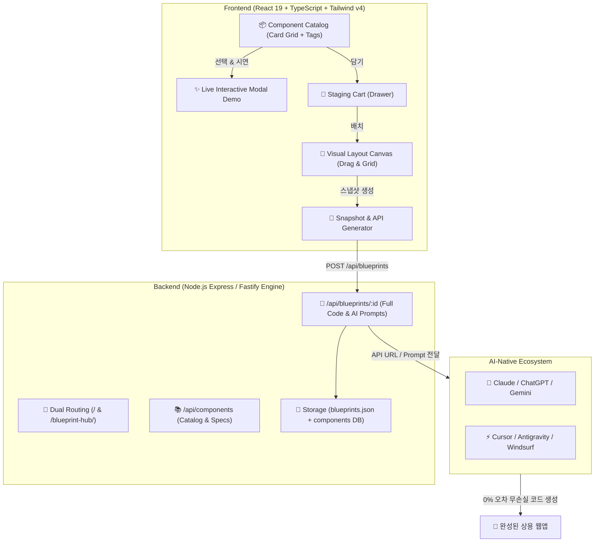

# 🚀 BlueprintHub (블루프린트 허브) - 아키텍처 및 시스템 설계서
> **2026 AI-Native Component & Layout Blueprint Design System**
> *"시각적으로 조립하고, 스냅샷 API로 AI와 0% 오차 완벽 구현"*

---

## 1. 🌟 프로젝트 개요 (Executive Summary)

### 1.1 배경 및 문제 정의 (Pain Points)
1. **자연어 프롬프트의 모호성 (Prompt Ambiguity)**:
   * "깔끔하고 세련된 대시보드 표 만들어줘"라고 지시하면 AI 모델마다, 실행 시점마다 완전히 다른 디자인과 코드가 생성됨.
   * 개발자와 AI 간의 커뮤니케이션 미스로 인한 반복적인 수정 요청과 토큰 낭비 발생.
2. **기존 UI 카탈로그(Storybook, Shadcn 등)의 한계**:
   * 사람이 직접 코드를 한 줄씩 복사/붙여넣기하여 수동 조립해야 함.
   * 여러 컴포넌트를 결합한 종합 레이아웃 청사진을 기계(AI)가 읽을 수 있는 형태로 제공하지 못함.

### 1.2 솔루션 (Core Solution)
* **2026 최신 트렌드 컴포넌트 카탈로그**: 데이터그리드, 차트, 폼, 피드백, 테마, AI 위젯 등 수백 개의 상용급 컨트롤 수록.
* **라이브 인터랙티브 체험 (Live Modal Demo)**: 카드 클릭 시 실제 데이터 조작 및 인터랙션 실시간 시연.
* **비주얼 캔버스 조립 (Visual Staging Canvas)**: 원하는 컴포넌트를 장바구니에 담아 1단/2단/대시보드 그리드 형태로 프리뷰.
* **스냅샷 & AI-Bridge API (`GET /api/blueprints/:id`)**:
  * 조합한 레이아웃을 고유 스냅샷으로 저장.
  * AI가 즉시 읽어들여 100% 일치하는 완성본 코드를 생성할 수 있는 완벽한 기계 판독형 JSON/Markdown 청사진 제공.

---

## 2. 🏛️ 시스템 아키텍처 (System Architecture)



---

## 3. 🎨 디자인 시스템 & 토큰 (Design Tokens)

`clinesr_skill`의 `gradient-dark-theme` 및 `ui-design-baseline`을 기반으로 구축된 고품격 딥 다크 글래스모피즘:

* **Background**: `#08090f` (딥 바이올렛 다크) + 다중 래디얼 글로우 오버레이
* **Surface**: `rgba(255, 255, 255, 0.03)` ~ `rgba(255, 255, 255, 0.07)` (Glassmorphism Blur: `16px`)
* **Border**: `rgba(255, 255, 255, 0.08)` (1px Ultra-fine Border)
* **Brand Gradient**: `linear-gradient(135deg, #6366f1 0%, #8b5cf6 50%, #d946ef 100%)`
* **Cyan Neon Gradient**: `linear-gradient(135deg, #06b6d4 0%, #3b82f6 100%)`
* **Typography**: 영문 `Inter` / 한글 `Pretendard`, 제목 `letter-spacing: -0.02em`

---

## 4. 📐 데이터 모델 (Data Models)

### 4.1 Component Schema (`ComponentItem`)
```typescript
export interface ComponentItem {
  id: string;               // e.g., 'datagrid-enterprise'
  name: string;             // '엔터프라이즈 실시간 데이터 그리드'
  category: string;         // 'tables' | 'charts' | 'forms' | 'dashboards' | 'navigation' | 'ai-widgets' | 'themes'
  tags: string[];           // ['table', 'grid', 'sort', 'filter', 'excel', '실시간']
  description: string;      // 상세 설명
  thumbnail: string;        // 썸네일 프리뷰 타입/아이콘
  complexity: 'Simple' | 'Medium' | 'Advanced';
  previewCode: string;      // 실제 동작 시연용 TSX 컴포넌트 코드
  fullSourceCode: string;   // AI 및 개발자가 가져갈 전체 완성본 소스
  cssTokens?: string;       // 필요한 추가 CSS / Tailwind 유틸
  dependencies: string[];   // ['lucide-react', 'recharts']
  aiPromptGuidance: string; // AI에게 주입할 역할 및 조립 가이드라인
}
```

### 4.2 Blueprint Snapshot Schema (`BlueprintSnapshot`)
```typescript
export interface BlueprintSnapshot {
  id: string;               // e.g., 'bp_2026_9x4b1'
  title: string;            // '2026 실시간 AI 트레이딩 대시보드 레이아웃'
  description: string;
  createdAt: string;
  author?: string;
  layout: {
    type: '1-col' | '2-col-equal' | 'dashboard-grid' | 'sidebar-main';
    slots: {
      slotId: string;
      componentId: string;
      customProps?: Record<string, any>;
    }[];
  };
  components: ComponentItem[];
  generatedAiPrompt: string;  // 원클릭 복사용 AI 프롬프트 전문
}
```

---

## 5. 🔌 API 명세서 (API Specification)

| Method | Endpoint | Description |
| :--- | :--- | :--- |
| `GET` | `/api/components` | 전체 컴포넌트 카탈로그 및 태그 목록 조회 (검색/필터 지원) |
| `GET` | `/api/components/:id` | 특정 컴포넌트 상세 스펙 및 소스코드 조회 |
| `POST` | `/api/blueprints` | 장바구니에 담긴 컴포넌트 레이아웃 스냅샷 생성 |
| `GET` | `/api/blueprints/:id` | AI 및 클라이언트가 참조할 전체 청사진 JSON 반환 |
| `GET` | `/api/blueprints/:id/prompt` | AI 프롬프트 전용 순수 Markdown 텍스트 반환 |
| `GET` | `/api/blueprints/recent` | 최근 생성된 공개 블루프린트 목록 조회 |

---

## 6. 🚀 배포 및 포트 할당 (Deployment Specs)

* **서비스 경로**: `/home/kw/kwsoft/blueprint-hub`
* **포트**: `10192`
* **외부 접속 URL**: `https://kwopi.duckdns.org/blueprint-hub/`
* **로컬 접속 URL**: `http://172.30.1.70:10192/blueprint-hub/`
* **라우팅 규격**: Dual Routing 지원 (`/` 및 `/blueprint-hub/`)
* **관리 스크립트**: `manage.sh` (`start`, `stop`, `restart`, `status`, `build`)
